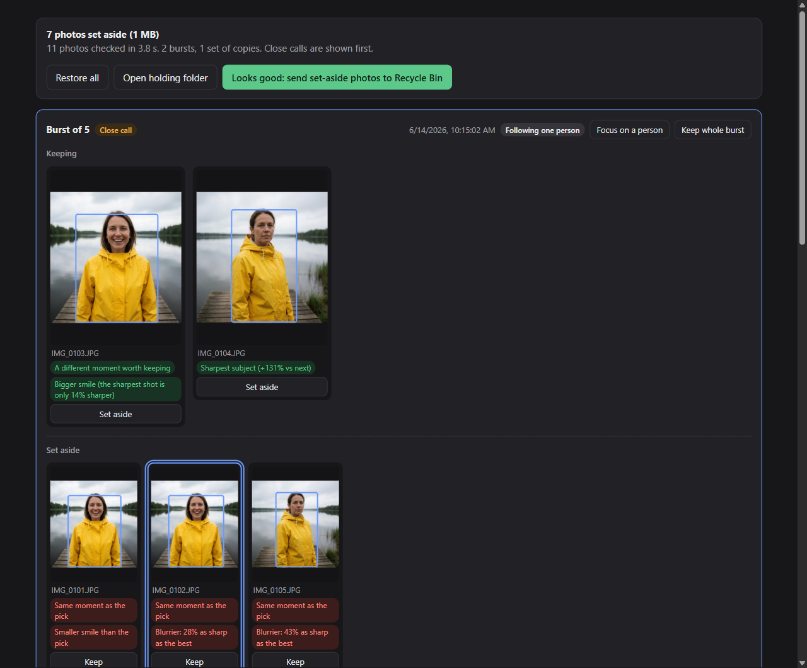
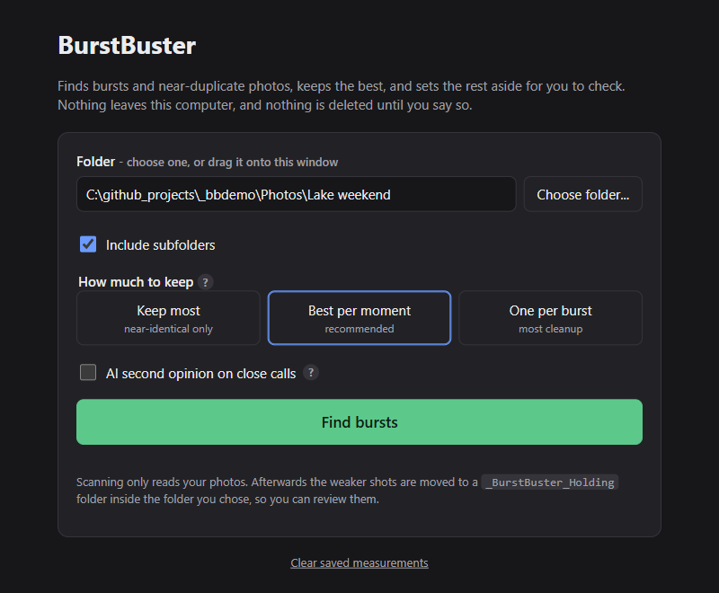
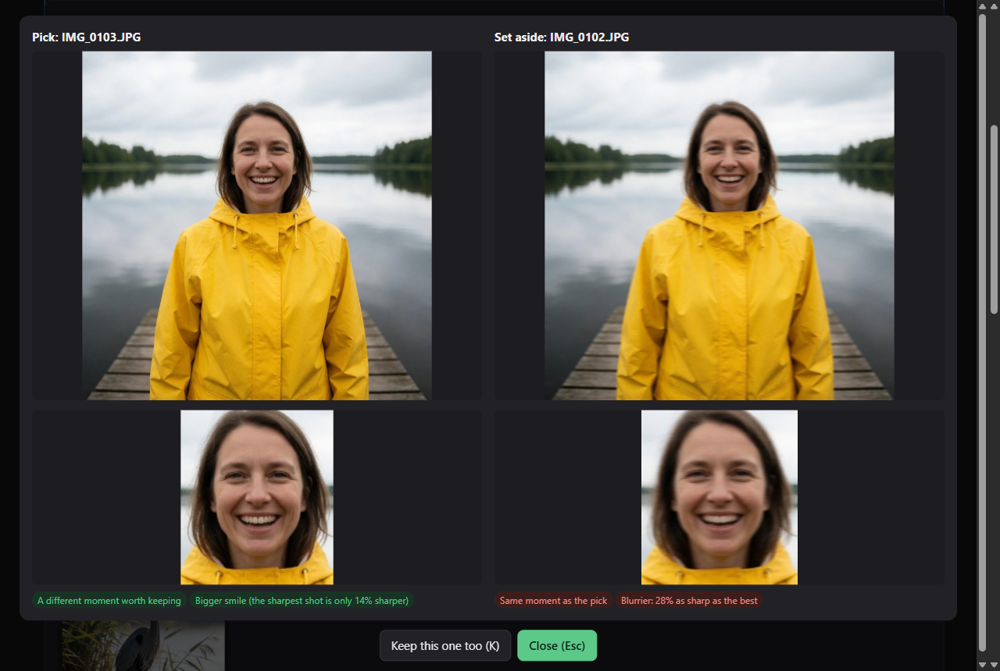
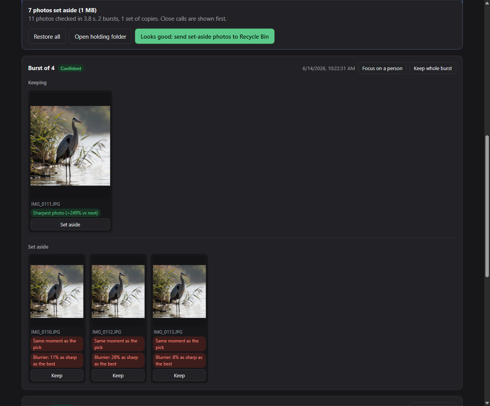

# BurstBuster

**Fired off 20 shots to get one good one? BurstBuster keeps the best shot of every moment and sets the rest
aside, with a plain-English reason for every choice.** Free, private, and fast on an ordinary computer:
Windows, Mac or Linux.

- **Picks like you would.** Eyes open first, then the subject in focus, then the bigger smile and facing the camera.
  It's not just for people: birds, kayaks, pets and night skies are judged on what's sharpest.
- **Explains every call.** "Eyes closed", "Blurrier: 28% as sharp as the best", "Darker: 45% as bright as the
  best", "Smaller copy of IMG_0120.JPG".
  Close calls go to the top so you can check them first.
- **Clears out copies too.** Switch to **DupeDestroyer** for a fast copies-only pass: exact copies, the same
  picture with different photo details, and smaller saves. The best-described, full-size copy is kept.
- **Never loses a photo.** Nothing is deleted until you approve it, and then it goes to the Recycle Bin (the Trash
  on Mac and Linux). One click restores everything.
- **Fast and light.** About 120 phone photos in 25 seconds on a desktop CPU, no graphics card needed, and a
  re-scan of the same folder in under a second ([numbers below](#speed-and-system-use)).
- **100% local.** No account, no upload, no telemetry. Your photos never leave your computer.

## Get started

1. Install [Python](https://www.python.org/downloads/) 3.11 or newer. On Windows, tick "Add python.exe to PATH".
2. Download the [latest release](https://github.com/EnragedAntelope/burstbuster/releases/latest) (Source code
   zip) and unzip it, or `git clone https://github.com/EnragedAntelope/burstbuster`.
3. Start it. The first run installs what it needs (a few minutes, internet needed once). After that it opens
   straight away.
   - **Windows:** double-click `START.bat`.
   - **Mac or Linux:** in a terminal, `cd` into the folder and run `./start.sh`.

Mac needs Apple Silicon (M1 or newer); Intel Macs are not supported by MediaPipe. On Debian or Ubuntu, first run
`sudo apt install python3-venv libgles2 libegl1` (start.sh tells you if something is missing).

## How to use it

1. Pick **BurstBuster** (bursts and copies) or **DupeDestroyer** (copies only: no AI models, so it is much
   faster and the options below are hidden). From the command line, `scan --dupes` does the same.
   Choose a folder (or drag one onto the window), decide whether to include subfolders, and pick how much to keep:
   - **Keep most**: only sets aside photos that are basically the same shot and clearly worse.
   - **Best per moment** (recommended): keeps the best photo of each distinct pose or moment.
   - **One per burst**: keeps just the single best photo.
2. Press **Find bursts** (or **Find duplicates**). The weaker shots move into a `_BurstBuster_Holding` folder inside the folder you chose.
3. Review. Click a photo (or press Space) to compare it side by side with the pick, including a face close-up.
   Press **Keep** on anything you want back; it moves back straight away.
   If a burst picked the wrong person, press **Focus on a person** and click the one you care about; the burst
   is picked again around them (this replaces your earlier keep / set-aside choices in that burst).
4. When you're happy, press **Looks good: send set-aside photos to Recycle Bin**. Or press **Restore all** to
   undo everything.

Keys: arrows move, K keep, X set aside, Space compare, Esc close, ? help.

## How it chooses

Photos taken seconds apart that look alike form a burst. Within a burst, photos with the same pose form a moment.
For each moment it first drops shots with a clear problem (eyes closed, subject blurrier than the best, clearly
darker than the best, more blown-out highlights), then ranks the rest by a bigger smile, facing the camera, and sharpness. Every burst
always keeps at least one photo, and a different moment is kept unless it is clearly worse. Darkness is judged
against the rest of the burst, so a night sky where every frame is dark loses nothing.

A photo with no face in it is never marked down for that when it shows a different moment: a bird, a sign or a
sunset is its own picture, judged on sharpness and exposure.

When several people share the frame, each photo is judged on the person who appears in most of the burst
(outlined in the review), and photos where that person is missing or much smaller rank lower.

It also tidies up copies:

- Live Photo videos, RAW+JPEG pairs and sidecar files always move together with their photo.
- Byte-identical copies anywhere in the folder are found.
- So is the same picture with different photo details: a copy where a rating, tag or date was written into the
  file (Explorer, Lightroom, exiftool) but the picture itself was not re-saved. JPEG, PNG and HEIC.
- Smaller saves of the same photo (same camera and capture time, same shape, for example an export or a shared
  copy) are found too, and the full-size one is kept.
- Among copies of one picture, the one kept is the first that wins on: companion files (Live Photo, RAW, sidecar),
  then more photo details (date, camera, place, rating), then a name that does not end in "copy" or "(1)", then
  the shortest path, then the oldest file. The reason is shown on the kept photo.
- **Keep photo details from copies that are removed** (off by default): when you send copies to the Recycle Bin,
  details the kept copy is missing (date taken, camera, place, rating, keywords, title, caption) are saved in a
  new sidecar file next to it, for example `IMG_1.jpg.xmp`, which digiKam, darktable and similar apps read
  (Windows Photos and Google Photos do not). The kept copy also takes the oldest copy's file date. The photo
  itself is never edited and an existing sidecar is never changed. Only blank details are filled in, and only
  keywords the kept copy lacks are added (ignoring case and spacing). Details the copies disagree on are left
  out, and a value a removed copy had that differs from the kept copy's is listed on the kept photo (the kept
  copy's value stays). The same date or place written with different precision counts as the same. If a sidecar can't be written, that set's copies are put back instead of recycled.

## Speed and system use

- **No graphics card needed.** Everything runs on the CPU with small models (about 100 MB in total, downloaded
  once and checked against fixed hashes).
- **Leaves your computer usable.** It uses at most half your CPU cores (up to 8), at roughly 400 MB of memory each.
- **Measured** on an Intel i7-13700KF (8 worker processes): 120 phone-sized photos (12 MP JPEG) in 25 seconds,
  peak memory 3.4 GB in total. A 4-core laptop runs 2 workers, so expect roughly 1 GB and a slower scan.
- **Re-scans are instant.** Measurements are cached, so scanning the same folder again took 0.1 seconds.

## Safety

- Scanning only reads your photos. Moves are journaled, so an interrupted run is settled the next time the app
  starts.
- Nothing is ever overwritten, and a photo changed since the scan is left where it is.
- Nothing is deleted permanently. On Windows network or removable drives (no Recycle Bin), set-aside photos stay
  in the holding folder for you to delete yourself.
- Cloud-only OneDrive files are skipped on Windows, so a scan never triggers downloads.

## Privacy

No accounts, no telemetry. The only internet use is the one-time download of the models.

**Optional AI second opinion.** If you run a local AI server with a vision model (LM Studio, Ollama or llama.cpp),
tick "AI second opinion" and it will settle close calls between equally good shots. The app only talks to servers
on this computer or your home network and refuses anything else. It never overrides the eyes-closed or blur checks.

## Command line

`.venv\Scripts\python -m burstbuster scan <folder> [--no-subfolders] [--level identical|pose|one] [--report out.json]`
prints what the app would do and moves nothing (on Mac and Linux, `.venv/bin/python`).

## Limits

Windows is the most tested platform; Mac and Linux pass the automated tests but have had less real use. Photos only (JPEG, HEIC, PNG and common RAW formats); videos are not analysed, though Live Photo
videos move with their photo.

## Bugs and ideas welcome

Found a photo it got wrong, a crash, or something confusing? Have an idea that would make it better?
**[Open an issue](https://github.com/EnragedAntelope/burstbuster/issues/new/choose)**. Every report helps.
Please describe the photos instead of attaching personal ones, unless you're happy for them to be public.

Pull requests are welcome too. Run the tests with `.venv\Scripts\python -m pytest tests -q` (or
`.venv/bin/python` on Mac and Linux); notes for working
on the code are in [AGENTS.md](AGENTS.md).

## Credits

Built on [MediaPipe](https://ai.google.dev/edge/mediapipe) (face, pose and object detection) and
[DINOv2](https://github.com/facebookresearch/dinov2) (image similarity), both Apache 2.0, plus
[pywebview](https://pywebview.flowrl.com/), Pillow, pillow-heif, rawpy, NumPy and ONNX Runtime.
The people and places in the screenshots are AI-generated, not real photos.
Thanks to [rtomephotography.com](https://rtomephotography.com/) for providing helpful dark test samples.

## License

[MIT](LICENSE)
